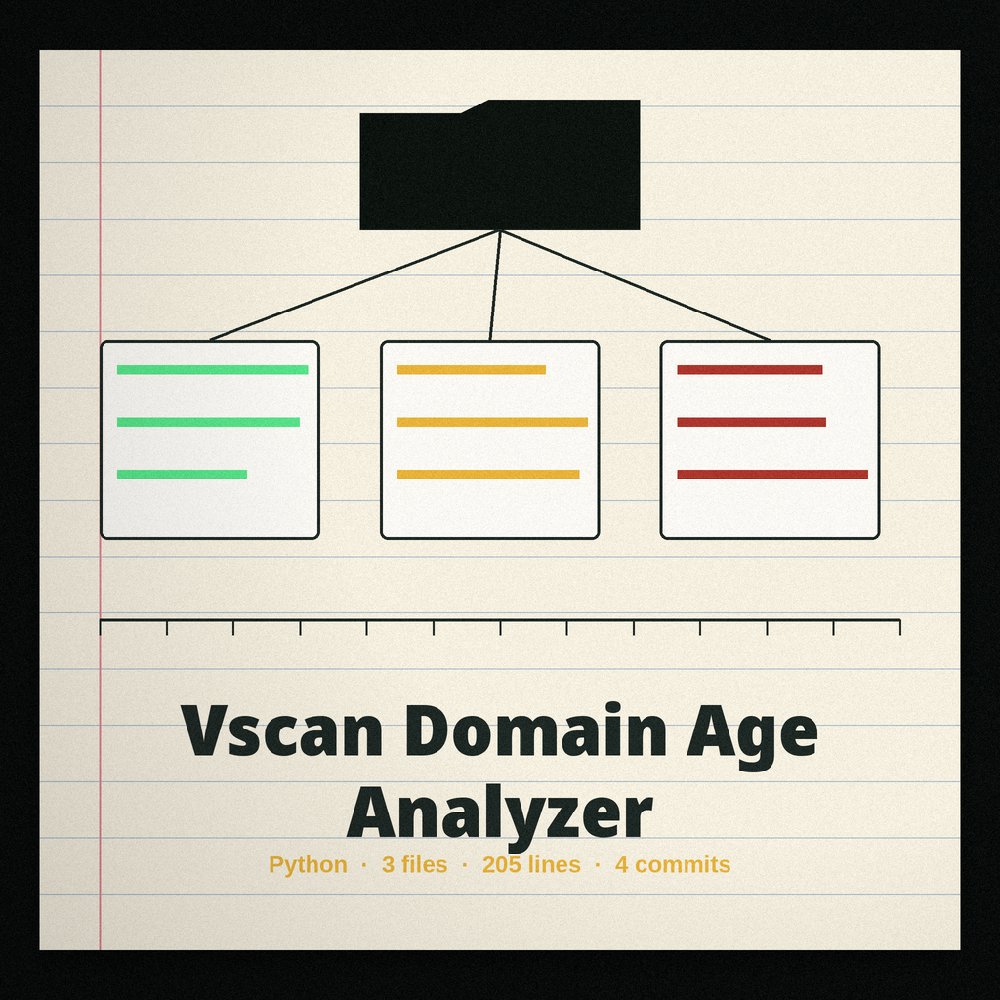
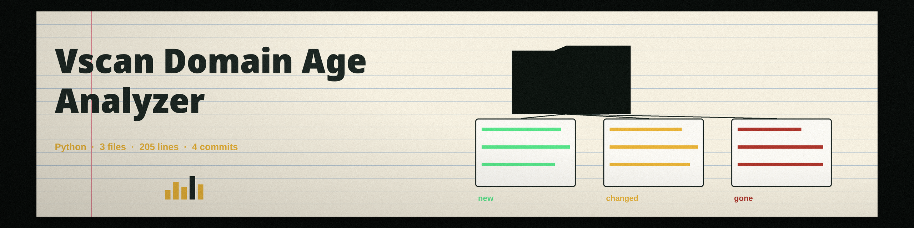

# vscan-domain-age-analyzer

Determines the age of a domain and of its associated domains, identifying potentially suspicious or newly registered domains often associated with phishing or malicious activities. Part of a lightweight web application vulnerability scanning collection focused on common misconfigurations.

## Data sources

By default, the age lookup scrapes the whois page of viewdns.info, a third party site, and parses the creation date out of its HTML. That default path sends the domain you name to viewdns.info. The parser accepts ISO dates (2020-01-02, including the date part of an ISO datetime), Mon-DD-YYYY, and DD-Mon-YYYY shapes.

Use `-w` to look the creation date up through the whois library instead. When a registry reports several creation dates, the earliest one is used, since the others can be renewal or transfer stamps.

With `-d`, A records come from address resolution, and MX and NS records come from MX and NS lookups through the resolver. Age lookups for returned MX and NS hosts run on the registered domain of each host, not on IP addresses, and each registered domain is looked up only once per run. The registered domain is the last two labels, or the last three when the last two form a known two-level public suffix such as co.uk (a short built-in list, not the full public suffix list).

An invalid domain format exits 1: at least two labels, no empty labels, labels of letters, digits, or hyphens that do not start or end with a hyphen, and a top level domain of at least two letters.

## Install

`git clone https://github.com/ShadowGuard-AI/vscan-domain-age-analyzer`

Requires Python 3 with requests, beautifulsoup4, dnspython, and python-whois (see requirements.txt).

## Usage

`python3 main.py <domain> [-d] [-w]`

Example: `python3 main.py example.com -d -w`

## Parameters

- `domain`: The domain to analyze (for example example.com).
- `-h`: Show help message and exit.
- `-d`, `--dns`: Check associated domains via DNS records (A, MX, NS). May increase analysis time.
- `-w`, `--whois`: Retrieve WHOIS information through the whois library instead of the default viewdns.info scrape. May be slow.

## License

MIT. See LICENSE.
